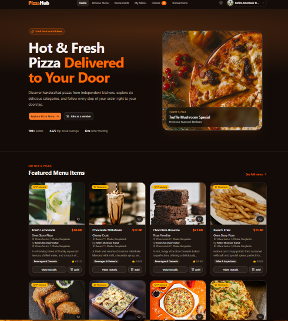
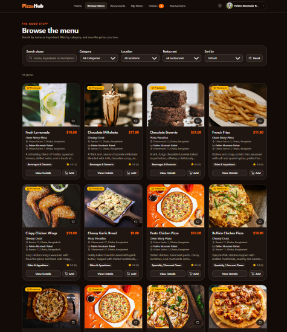
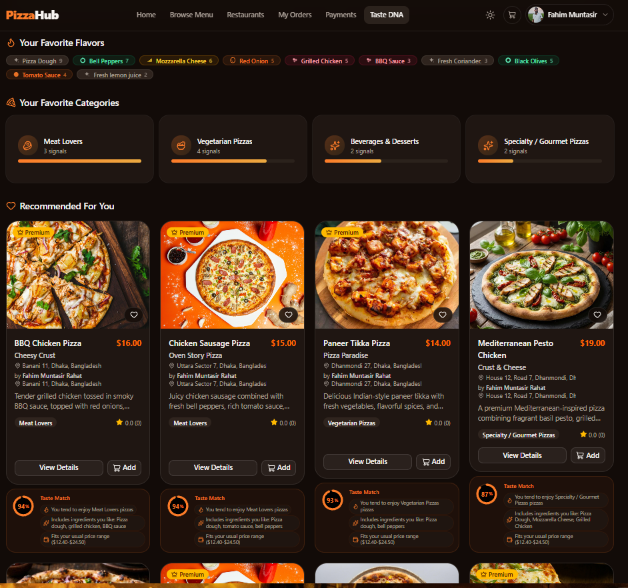
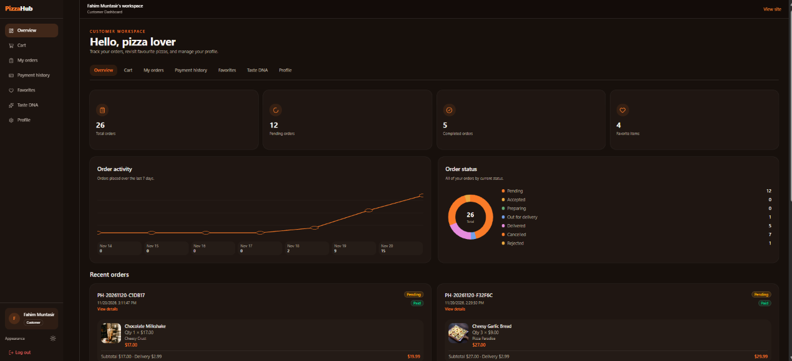
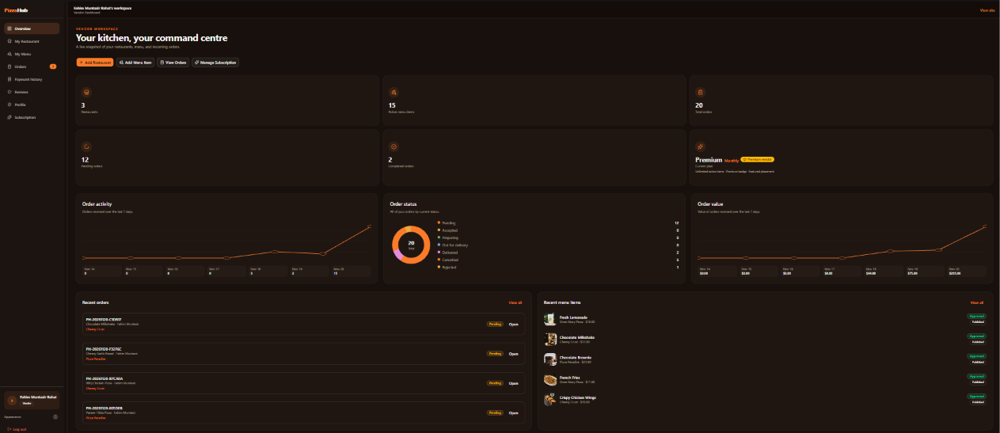
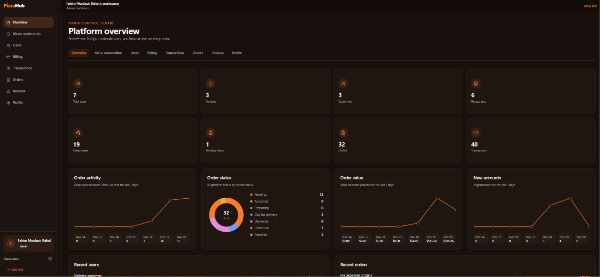

 <div align="center">

# 🍕 PizzaHub

### Discover Your Next Favorite Slice.

**A full-stack pizza marketplace with role-based workspaces, secure ordering, Stripe payments, and a personalized Taste DNA discovery experience.**

[](https://pizzahub-mocha.vercel.app/)
[](https://nextjs.org/)
[](https://react.dev/)
[](https://www.typescriptlang.org/)
[](https://tailwindcss.com/)

</div>

---

## 📌 Overview

PizzaHub is a modern pizza discovery and ordering marketplace built with **Next.js, React, TypeScript, and an Express API**. It brings customers, restaurant vendors, and administrators together in one platform.

Customers can explore restaurants and menus, manage favorites, place orders, pay securely, and track order progress. Vendors can manage their restaurants, menu items, customer orders, reviews, and Premium subscriptions. Administrators have dedicated tools for platform oversight, moderation, and transaction management.

At the heart of the customer experience is **Taste DNA** — PizzaHub's personalized taste-profile and recommendation experience. It uses a customer's activity on the platform to present a profile of favorite ingredients, preferred categories, budget range, and personalized menu recommendations with match scores and reasons.

🌐 **Live Website:** [https://pizzahub-mocha.vercel.app/](https://pizzahub-mocha.vercel.app/)

---

## 🧬 Taste DNA — Your Personal Pizza Fingerprint

Taste DNA is one of PizzaHub's signature features. It makes menu discovery more personal by turning a customer's activity on the platform into a readable taste profile and tailored recommendations.

Instead of showing everyone the same generic recommendations, Taste DNA presents preference insights derived from the customer's own PizzaHub activity.

### What Makes Taste DNA Special?

| Feature | Description |
|---|---|
| **Personal Taste Profile** | Displays a personalized summary of the customer's food preferences. |
| **Preference Signals** | Shows the total number of analyzed preference signals contributing to the profile. |
| **Favorite Ingredients** | Identifies preferred ingredients and displays their signal counts. |
| **Top Categories** | Highlights the customer's most preferred pizza and food categories. |
| **Budget Intelligence** | Displays a budget label — Budget-friendly, Mid-range, or Premium — and a price range when sufficient order history exists. |
| **Taste Match Score** | Shows how closely recommended menu items match the customer's taste profile. |
| **Recommendation Reasons** | Explains why a particular menu item matches the customer's preferences. |
| **Profile Status** | Indicates whether the taste profile is still developing or ready. |

### How Taste DNA Works

1. A signed-in customer visits the Taste DNA page or dashboard panel.
2. The frontend requests personalized data from the PizzaHub recommendation API.
3. The API returns a taste profile and recommended menu items.
4. The interface displays the taste summary, preference signals, favorite ingredients, top categories, and budget range.
5. Each recommended menu item includes a match score and reasons explaining the recommendation.
6. As customers build more activity through orders, favorites, and reviews, their taste profile can gain more preference signals.

### Taste DNA API

```http
GET /api/recommendations/taste-dna?limit=8
Authorization: Bearer <token>
```

The frontend integrates this endpoint through `getTasteDna()` in:

```text
src/lib/recommendations.ts
```

The Taste DNA page is customer-only and protected by authentication. It also includes loading, error, retry, and empty-profile states.

> **Implementation note:** Taste DNA is a personalized recommendation system powered by the PizzaHub backend API. The frontend consumes the API's taste-profile and recommendation response.

---

## ✨ Key Features

### 🛒 Customer Features

- Browse pizza menus and restaurant listings.
- Search and explore menu items.
- View detailed menu item and restaurant pages.
- Add products to the shopping cart.
- Manage cart items and quantities.
- Complete checkout with delivery information and a delivery date.
- Continue to Stripe Checkout for online payments.
- View order history and order details.
- Track order status and progress.
- Save favorite menu items.
- Write and view restaurant and menu-item reviews.
- Access a personalized customer dashboard.
- Explore personalized recommendations through Taste DNA.

### 🏪 Vendor Features

- Dedicated vendor dashboard.
- Create and manage restaurant information.
- Add, edit, and delete menu items.
- Manage incoming customer orders.
- View individual order details.
- Accept or reject customer orders.
- Manage customer reviews and feedback.
- View vendor payment and transaction information.
- Manage Premium subscriptions and billing options.

### 🛡️ Admin Features

- Dedicated admin dashboard.
- Review and manage platform orders.
- View individual order details.
- Moderate customer reviews.
- Access platform transaction information.
- Manage transaction and billing pages.
- Role-protected administration routes.

### 🔐 Authentication & Security

- Email and password authentication using Better Auth.
- Google OAuth sign-in support.
- JWT-based API authentication.
- Customer, vendor, and admin role support.
- Protected dashboard routes.
- Protected Taste DNA experience.
- Unauthorized-access and blocked-account pages.
- Session-aware frontend authentication.
- API token caching.
- Automatic token refresh and a single retry after an unauthorized response.
- Backend-managed authorization for protected operations.

### 💳 Payments, Uploads & Notifications

- Stripe Checkout integration for customer orders.
- Stripe-based vendor Premium subscription flow.
- Payment success and cancellation pages.
- Transaction and payment history interfaces.
- Image upload through the backend API.
- ImgBB integration handled server-side.
- Order and order-status email notifications through Resend.

### 🎨 UI & User Experience

- Responsive design for desktop, tablet, and mobile.
- Light and dark theme support.
- Reusable UI components.
- Form handling and validation.
- Loading skeletons and empty states.
- Error handling and retry functionality.
- Toast notifications.
- Shared public navigation.
- Role-specific dashboard layouts.

---

## 🖼️ Screenshots

Add screenshots captured from the deployed application inside `docs/screenshots/`.

| Home Page | Menu |
|---|---|
|  |  |

| Taste DNA | Customer Dashboard |
|---|---|
|  |  |

| Vendor Dashboard | Admin Dashboard |
|---|---|
|  |  |

---

## 🧰 Technology Stack

### Core Technologies

| Technology | Version | Purpose |
|---|---|---|
| Next.js | 16.4.6 | React framework and App Router |
| React | 19.3.0 | UI development |
| React DOM | 19.3.0 | React rendering |
| TypeScript | ^5 | Static typing |
| Tailwind CSS | 4.3.3 | Styling |
| Tailwind Turbopack | 4.3.3 | Tailwind integration with Turbopack |

### Authentication & Database

| Package | Version | Purpose |
|---|---|---|
| `better-auth` | ^1.7.25 | Authentication and session management |
| `@better-auth/mongo-adapter` | ^1.7.25 | MongoDB adapter for Better Auth |
| `mongodb` | ^7.9.0 | MongoDB Node.js driver |

### Forms, Validation & UI

| Package | Version | Purpose |
|---|---|---|
| `react-hook-form` | ^7.92.0 | Form management |
| `@hookform/resolvers` | ^7.0.7 | Form validation integration |
| `zod` | ^4.6.7 | Schema validation |
| `@base-ui/react` | ^1.9.0 | Accessible UI primitives |
| `shadcn` | ^4.23.0 | UI component tooling |
| `class-variance-authority` | ^0.7.1 | Component variants |
| `cn` | ^0.5.2 | Class-name utility |
| `lucide-react` | ^1.74.0 | Icon library |
| `sonner` | ^2.0.8 | Toast notifications |
| `tw-animate-css` | ^1.4.0 | Animation utilities |
| `motion` | ^14.14.0 | UI animations |

### Development Dependencies

| Package | Version | Purpose |
|---|---|---|
| `typescript` | ^5 | TypeScript support |
| `eslint` | ^9 | Code linting |
| `eslint-config-next` | 16.4.6 | Next.js ESLint configuration |
| `@types/node` | ^20 | Node.js type definitions |
| `@types/react` | ^19 | React type definitions |
| `@types/react-dom` | ^19 | React DOM type definitions |
| `babel-plugin-react-compiler` | 1.0.0 | React Compiler plugin |

### External Services

| Service | Purpose |
|---|---|
| MongoDB | Application and authentication data |
| Better Auth | Authentication and JWT issuance |
| PizzaHub Express API | Backend operations and marketplace data |
| Stripe | Customer checkout and vendor subscriptions |
| ImgBB | Image hosting through backend upload proxy |
| Resend | Transactional email delivery |
| Vercel | Frontend hosting and deployment |

---

## 📁 Project Structure

```text
pizzahub-client/
├── public/
├── src/
│   ├── app/
│   │   ├── (auth)/
│   │   │   ├── login/
│   │   │   └── register/
│   │   ├── api/
│   │   │   └── auth/[...all]/
│   │   ├── auth/callback/
│   │   ├── blocked/
│   │   ├── cart/
│   │   ├── checkout/
│   │   ├── contact-support/
│   │   ├── dashboard/
│   │   │   ├── admin/
│   │   │   ├── billing/
│   │   │   ├── customer/
│   │   │   ├── transactions/
│   │   │   └── vendor/
│   │   ├── menu/
│   │   │   └── [id]/
│   │   ├── payment/
│   │   │   ├── cancel/
│   │   │   └── success/
│   │   ├── restaurants/
│   │   │   └── [id]/
│   │   ├── taste-dna/
│   │   ├── terms-of-use/
│   │   ├── unauthorized/
│   │   ├── error.tsx
│   │   ├── global-error.tsx
│   │   ├── layout.tsx
│   │   ├── loading.tsx
│   │   ├── not-found.tsx
│   │   └── page.tsx
│   ├── components/
│   │   ├── auth/
│   │   ├── cart/
│   │   ├── checkout/
│   │   ├── dashboard/
│   │   ├── layout/
│   │   ├── payments/
│   │   ├── public/
│   │   ├── shared/
│   │   ├── theme/
│   │   └── ui/
│   ├── lib/
│   │   ├── api.ts
│   │   ├── auth-client.ts
│   │   ├── auth-guards.ts
│   │   ├── auth.ts
│   │   ├── mongodb.ts
│   │   ├── payment-api.ts
│   │   ├── recommendations.ts
│   │   ├── reviews.ts
│   │   ├── roles.ts
│   │   ├── subscriptions.ts
│   │   └── types.ts
│   └── proxy.ts
├── components.json
├── next.config.ts
├── package.json
└── tsconfig.json
```

---

## ⚙️ Getting Started

### Prerequisites

Before running the project, make sure you have:

- Node.js compatible with Next.js 16.
- npm installed.
- A MongoDB database.
- PizzaHub Express backend running locally or deployed.
- Stripe credentials for payment testing.
- Google OAuth credentials if you want to test Google sign-in.

### 1. Clone the Repository

```bash
git clone <CLIENT_REPOSITORY_URL>
cd pizzahub-client
```

### 2. Install Dependencies

```bash
npm install
```

### 3. Configure Environment Variables

Create a `.env.local` file in the project root.

```env
# Frontend API and authentication URLs
NEXT_PUBLIC_API_URL=http://localhost:5000
NEXT_PUBLIC_AUTH_URL=http://localhost:3000

# Better Auth configuration
BETTER_AUTH_URL=http://localhost:3000
BETTER_AUTH_SECRET=replace_with_a_long_random_secret
FRONTEND_URL=http://localhost:3000

# MongoDB configuration
MONGODB_URI=mongodb+srv://<username>:<password>@<cluster-url>/
DB_NAME=pizzahub

# Google OAuth (Optional)
GOOGLE_CLIENT_ID=your_google_client_id
GOOGLE_CLIENT_SECRET=your_google_client_secret
```

### Environment Variables Reference

| Variable | Required | Description |
|---|---|---|
| `NEXT_PUBLIC_API_URL` | Yes | Base URL of the Express backend API. |
| `NEXT_PUBLIC_AUTH_URL` | Yes | Better Auth URL used by the browser authentication client and token request. |
| `BETTER_AUTH_URL` | Yes | Better Auth server URL, also used for JWT issuer and audience. |
| `BETTER_AUTH_SECRET` | Yes | Secret used by Better Auth. Must match the backend configuration. |
| `FRONTEND_URL` | Recommended | Frontend origin trusted by Better Auth. |
| `MONGODB_URI` | Yes | MongoDB connection string used by the Better Auth adapter. |
| `DB_NAME` | Yes | MongoDB database name. |
| `GOOGLE_CLIENT_ID` | Optional | Google OAuth client ID. |
| `GOOGLE_CLIENT_SECRET` | Optional | Google OAuth client secret. |

**Security Notes:**

- Never commit `.env.local` to GitHub.
- Never expose private API keys or secrets through `NEXT_PUBLIC_*` variables.
- Keep Better Auth configuration aligned between frontend and backend.
- Use a strong random value for `BETTER_AUTH_SECRET`.

### 4. Start the Backend

Run the PizzaHub Express backend in a separate terminal.

Follow the backend repository's README for backend installation and environment configuration.

The frontend's local API URL is:

```text
http://localhost:5000
```

### 5. Start the Frontend

```bash
npm run dev
```

Open the application:

```text
http://localhost:3000
```

---

## 📜 Available Scripts

| Command | Description |
|---|---|
| `npm run dev` | Starts the Next.js development server. |
| `npm run build` | Builds the application for production. |
| `npm start` | Starts the production server after building. |
| `npm run lint` | Runs ESLint to check code quality. |

---

## 🔄 Frontend API & Authentication Flow

PizzaHub uses a shared API helper located at:

```text
src/lib/api.ts
```

This helper manages authenticated requests to the Express backend.

### Protected API Request Flow

1. A protected frontend feature calls `apiFetch()`.
2. The helper obtains a JWT from the Better Auth token endpoint.
3. The token is cached until shortly before expiration.
4. The API request includes the token in the Authorization header.
5. If the API returns `401`, the client clears the cached token.
6. It requests a fresh token and retries the request once.
7. If the retry also returns `401`, the client signs out and redirects to `/login`.
8. If the API returns `403` with `ACCOUNT_BLOCKED`, the client redirects to `/blocked`.

Public API requests can use `publicApi()` without an authenticated bearer token.

### Image Upload Flow

The frontend validates the image type and file size before uploading.

Supported image formats:

- JPEG
- PNG
- WebP
- GIF

The frontend sends the raw image bytes to:

```http
POST /api/uploads/image
```

The backend handles the ImgBB integration, keeping the private ImgBB API key out of the browser.

---

## 💳 Payment Integration

PizzaHub uses Stripe for secure online payments.

The frontend supports:

- Customer order checkout.
- Stripe Checkout redirection.
- Payment success page.
- Payment cancellation page.
- Vendor Premium subscription flow.
- Billing and transaction interfaces.

Payment processing and webhook verification are handled by the backend.

---

## 🔗 Project Links

| Resource | Link |
|---|---|
| **Live Website** | [PizzaHub](https://pizzahub-mocha.vercel.app/) |
| **Client Repository** | `<CLIENT_REPOSITORY_URL>` |
| **Server Repository** | `<SERVER_REPOSITORY_URL>` |

---

## ✅ Verification

Before submitting changes or deploying the application, run:

```bash
npm run lint
npm run build
```

For backend routes, authentication middleware, payment webhooks, and integration testing, follow the verification instructions in the server repository.

---

## 📝 Notes for Contributors

- Keep frontend and backend Better Auth configurations aligned.
- Enforce authorization on the backend; frontend route guards alone are not sufficient.
- Never expose server-side secrets in browser environment variables.
- Keep Taste DNA UI types aligned with the `TasteDnaResponse` contract in `src/lib/types.ts`.
- Add real screenshots under `docs/screenshots/`.
- Keep API routes and environment variable documentation up to date.
- Test customer, vendor, and admin workflows when changing role-based features.

---

<div align="center">

### Made with 🍕 and a Little Extra Flavor.

**[Visit PizzaHub](https://pizzahub-mocha.vercel.app/)**

</div>
